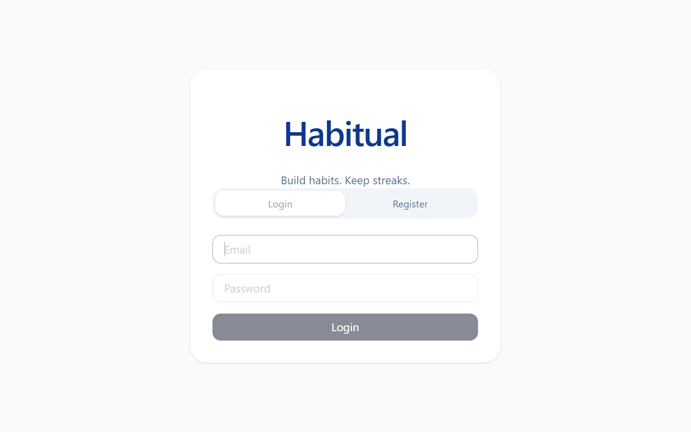
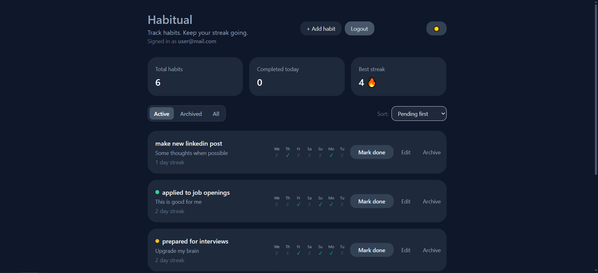
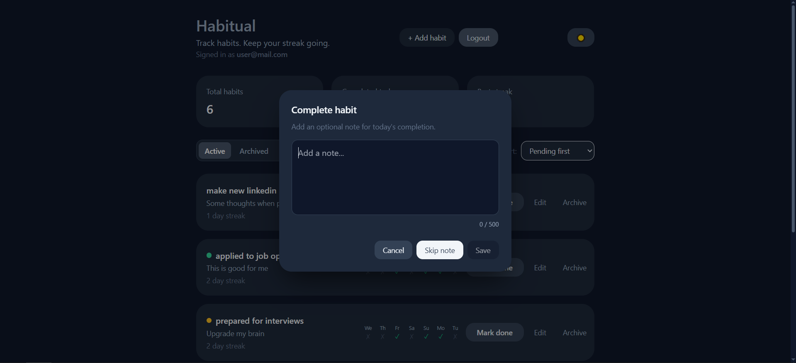
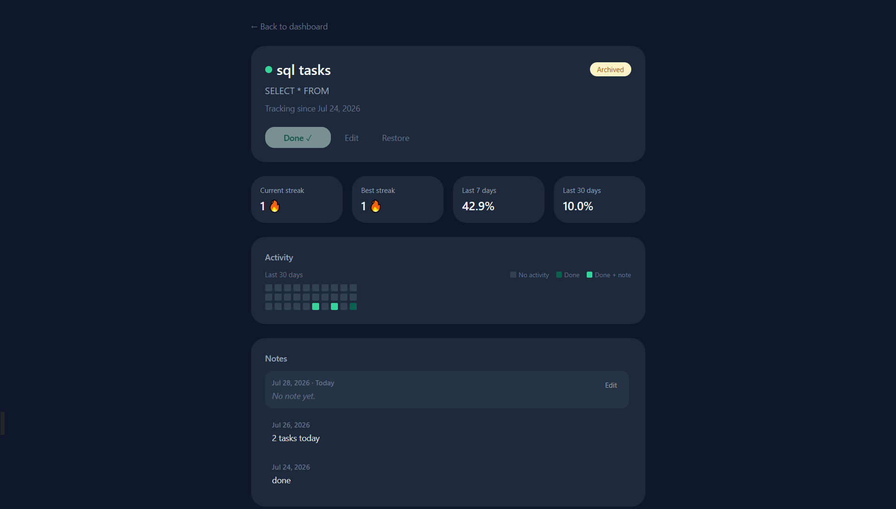

> React frontend for [Habitual API](https://github.com/Zhelero/habitual_api) — a habit tracking app with streak statistics and 30-day heatmap.


---

## Screenshots
#### Login

#### Dashboard

#### Habit completion dialog

#### Habit page


---

## Features

- Login and registration with JWT authentication, with password confirmation on sign-up
- Auto-refresh of access token via refresh token rotation
- Dashboard with total habits, completed today, and best streak
- Habit CRUD — create, edit, archive / restore (no hard delete)
- Custom color per habit, shown on the dashboard and detail page
- 7-day activity strip on each dashboard habit card
- Filter habits by Active / Archived / All, with a dedicated empty state per filter
- Sort by pending, completed, streak, or alphabetically
- Mark habits as done / undo, with an optional note attached to today's completion
- Edit today's note at any time; past days are read-only
- Notes list on the habit detail page (newest first, today always shown when done)
- Shared `Modal` component behind every dialog (create/edit habit, mark-done note, edit note) — closable via Escape or a click on the backdrop, with a live `x / 500` character counter on note inputs
- Dedicated habit detail page (`/habits/:id`) with full stats and a full-size 30-day heatmap
- Three-state heatmap (no activity / done / done + note) with a legend and a tooltip showing the note on hover
- Persisted dark mode, applied consistently across every route
- Filter and sort selection persisted in the URL (shareable, survives refresh, cleared on logout)
- Toast notifications for success and API validation errors (success toasts auto-dismiss, errors stay until closed)
- End-to-end test suite (Playwright, 59 tests) covering auth, habit CRUD, dialogs, notes, heatmap, color selection, and dashboard persistence
- CI pipeline (GitHub Actions): lint, then E2E tests run against a real backend + PostgreSQL, checked out and started inside the same workflow

---

## Tech Stack

| Layer      | Technology          |
|------------|---------------------|
| Framework  | React 18            |
| Routing    | React Router 7      |
| Build tool | Vite                |
| Styling    | Tailwind CSS        |
| Auth       | JWT (access + refresh tokens) |
| API client | fetch (native)      |
| State      | React Context + hooks |
| E2E testing | Playwright         |
| Linting    | ESLint 9 (flat config) |

---

## Routes

| Route          | Description                                              |
|----------------|-----------------------------------------------------------|
| `/`            | Dashboard — habit list, filters, sorting                  |
| `/habits/:id`  | Habit detail — streak/completion stats, heatmap, edit, archive |

Unauthenticated visitors are shown the login/register screen regardless of route.

---

## Project Structure
src/

├── components/

│   ├── HabitCard.jsx           # habit row on the dashboard list

│   ├── HabitsList.jsx          # renders the filtered/sorted list of HabitCards

│   ├── HabitForm.jsx           # create / edit fields, shared by the dialog and embedded contexts

│   ├── HabitDialog.jsx         # create/edit habit dialog (wraps HabitForm in Modal)

│   ├── CompletionNoteDialog.jsx # optional note dialog shown when marking a habit done

│   ├── EditNoteDialog.jsx      # edit today's note dialog

│   ├── NotesList.jsx           # notes list on the habit detail page

│   ├── Modal.jsx               # shared dialog shell — Escape/backdrop-click to close

│   ├── Heatmap.jsx             # 30-day activity heatmap (none / done / done+note)

│   ├── DashboardHeader.jsx     # dashboard title + add-habit entry point

│   ├── DashboardStats.jsx      # total / completed-today / best-streak summary

│   ├── DashboardToolbar.jsx    # filter (Active/Archived/All) and sort controls

│   ├── Toast.jsx               # single toast (success auto-dismisses, error persists)

│   ├── ToastContainer.jsx      # toast stacking/positioning

│   ├── ThemeToggle.jsx         # dark mode switch

│   ├── LoadingScreen.jsx       # route-level loading state

│   ├── ErrorScreen.jsx         # route-level error state

│   ├── LoginForm.jsx           # login form

│   └── RegisterForm.jsx        # registration form

├── context/

│   ├── AuthContext.jsx      # AuthProvider component (login/logout, token state)

│   └── authContextObject.js # raw React context object (kept separate for Fast Refresh)

├── hooks/

│   ├── useAuth.js           # useAuth hook (reads AuthContext)

│   ├── useHabits.js         # list + stats fetching for the dashboard

│   ├── useHabit.js          # single habit + stats + heatmap for the detail page

│   └── useHabitActions.js   # create/edit/archive/mark-done/note mutations shared by dashboard and detail page

├── utils/

│   ├── sortHabits.js

│   ├── apiErrors.js         # getApiErrorMessage — formats API validation errors for toasts

│   └── habitColors.js       # HABIT_COLORS palette + habitColorClass helper

├── AuthPage.jsx              # login / register screen

├── HabitualDashboard.jsx      # dashboard: list, filters, sorting

├── HabitDetailPage.jsx        # /habits/:id — full stats, heatmap, notes, edit/archive

├── api.js                     # API client with auth headers

├── App.jsx                    # route definitions + dark mode state

└── main.jsx                   # React Router + AuthProvider setup

e2e/                          # Playwright end-to-end tests (59 tests)

├── auth.spec.js                 # login / registration / token refresh

├── habits.spec.js               # habit CRUD, editing, archiving, validation

├── habit-detail.spec.js         # detail page navigation, stats, edit, archive

├── habit-heatmap.spec.js        # heatmap cell states and legend

├── notes-list.spec.js           # notes list rendering, editing, persistence

├── modal.spec.js                # dialog behavior (Escape/backdrop/Cancel, char counter) across all dialogs

├── dashboard-persistence.spec.js # theme, completion state, and filter surviving reload

├── habit-color.spec.js          # color picker and color persistence

├── fixtures.js                   # authedPage / registeredUser fixtures

├── helpers.js                    # shared test helpers (createHabitViaUI, markHabitDoneViaUI, uniqueEmail)

└── global-setup.js               # test environment bootstrap

.github/workflows/

└── ci.yml                       # lint job + e2e job (checks out habitual_api, runs it in Docker, then Playwright)

---

## Getting Started

### Prerequisites

- Node.js 18+
- [Habitual API](https://github.com/Zhelero/habitual_api) running on `http://localhost:8000`

### Install and run

```bash
git clone https://github.com/Zhelero/habitual_ui
cd habitual_ui

npm install
npm run dev
```

UI will be available at `http://localhost:5173`

---

## Running E2E tests

```bash
npx playwright install   # first time only
npm run test:e2e
```

Tests run against a live API on `http://localhost:8000`, so make sure the backend is up first. Each test registers its own user, so runs are isolated from each other.

---

## CI

On every push/PR, GitHub Actions runs two jobs:

1. **lint** — ESLint against the whole codebase
2. **e2e** — checks out [habitual_api](https://github.com/Zhelero/habitual_api) into the same job, starts it with Docker (Postgres + FastAPI, migrations included), waits for `/health`, then runs the full Playwright suite against that live backend. The Playwright HTML report is uploaded as a build artifact either way, so a failing run can be inspected without reproducing it locally.

The two repos stay separate, but tests always run against the real API, not a mock.

---

## Running the full stack

```bash
# Terminal 1 — API
cd habitual_api
uvicorn app.main:app --reload

# Terminal 2 — UI
cd habitual_ui
npm run dev
```

---

## Related

- [habitual_api](https://github.com/Zhelero/habitual_api) — FastAPI backend with PostgreSQL, JWT auth, and 98% test coverage